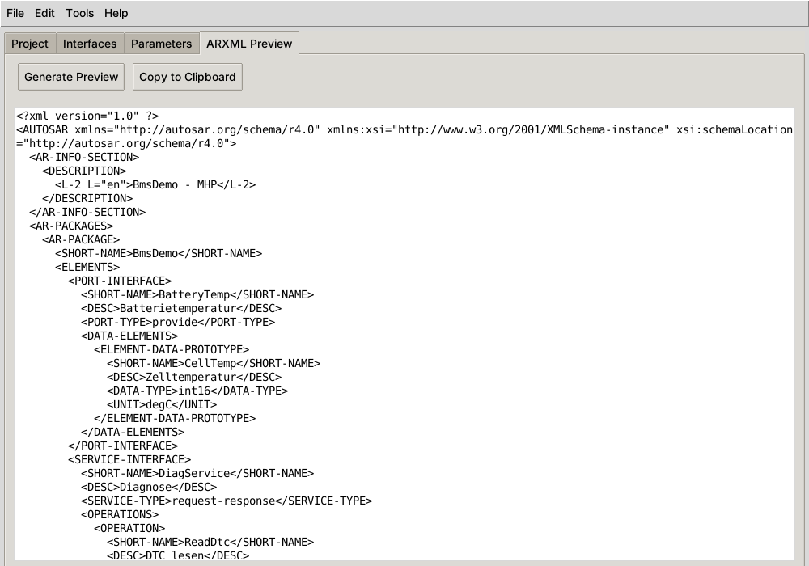

# ARXML GUI Generator

Eine schlanke Python/Tkinter-Anwendung, mit der sich AUTOSAR-Schnittstellenbeschreibungen
(Services, Ports, Signale inkl. Operationen und Parameter) erfassen und als ARXML-Datei
ausgeben lassen. Ziel ist ein leichtgewichtiges Werkzeug für Prototypen, PoCs und
Schulungen – ohne Lizenz für ein großes AUTOSAR-Autorenwerkzeug.



> **Projektstatus: frühe Entwicklungsphase (v0.x).**
> Das Datenmodell, der ARXML-Generator und der Validator funktionieren und lassen sich per
> Python nutzen. In der GUI sind bisher nur Projektanlage, Vorschau, Validierung, Speichern
> und ARXML-Export angebunden – Interfaces können über die Oberfläche noch nicht angelegt
> werden. Die erzeugte ARXML ist **noch nicht AUTOSAR-schemakonform**.
> Details: [Funktionsumfang](#funktionsumfang) und [Bekannte Einschränkungen](docs/entwicklung.md#bekannte-einschränkungen).

---

## Inhalt

- [Funktionsumfang](#funktionsumfang)
- [Voraussetzungen](#voraussetzungen)
- [Installation](#installation)
- [Schnellstart](#schnellstart)
- [Dokumentation](#dokumentation)
- [Projektstruktur](#projektstruktur)
- [Roadmap](#roadmap)
- [Mitwirken](#mitwirken)
- [Lizenz](#lizenz)

---

## Funktionsumfang

| Bereich | Funktion | Status |
|---|---|---|
| **Projekt** | Projektname, Vendor, AUTOSAR-Version, Namespace festlegen | ✅ in der GUI |
| | Projekt als JSON speichern | ✅ in der GUI |
| | Projekt aus JSON laden | ⚠️ Datei wird gelesen, aber nicht in die GUI übernommen |
| **Interfaces** | Datenmodell für Service-, Port- und Signal-Interfaces | ✅ per Python-API |
| | Interfaces in der GUI anlegen / bearbeiten / löschen | 🚧 Dialoge vorhanden, im Hauptfenster noch nicht angebunden |
| | Operationen (Service) und Daten-Elemente (Port) | ✅ per Python-API |
| **Parameter** | Parameter mit Typ, Min/Max/Default und Metadaten | ✅ per Python-API |
| | Parameter-Vorlagen *Timing*, *Communication*, *Safety* | ✅ im Modell, GUI zeigt nur die Namen |
| | Parameter in der GUI pflegen | 🚧 Platzhalter |
| **ARXML** | ARXML erzeugen, Live-Vorschau, in Zwischenablage kopieren | ✅ in der GUI |
| | Als `.arxml` exportieren | ✅ in der GUI |
| | ARXML importieren | 🚧 Parser vorhanden, erkennt aber keine Dateien mit AUTOSAR-Namespace; Menüpunkt nicht angebunden |
| | Schemakonformität zu AUTOSAR R4.x | ❌ eigene Tag-Namen, siehe [ARXML-Ausgabe](docs/arxml-ausgabe.md) |
| **Validierung** | Namensregeln, Pflichtfelder, AUTOSAR-Version, Min/Max-Konsistenz | ✅ in der GUI |
| **Export** | Parameter als CSV/JSON | 🚧 Konverter vorhanden, Menüpunkte sind Platzhalter |

Legende: ✅ nutzbar · ⚠️ teilweise · 🚧 in Arbeit · ❌ fehlt noch

## Voraussetzungen

- **Python 3.11 oder neuer** (getestet: GUI mit 3.12, Kernmodule und Tests mit 3.11–3.13)
- **Tkinter** – ist Teil der Python-Standardbibliothek, muss unter Linux aber oft separat
  installiert werden:

  | System | Installation |
  |---|---|
  | Windows / macOS (python.org-Installer) | bereits enthalten |
  | Debian / Ubuntu / WSL2 | `sudo apt install python3-tk` |
  | Fedora | `sudo dnf install python3-tkinter` |
  | Arch | `sudo pacman -S tk` |

  Prüfen: `python -c "import tkinter; print(tkinter.TkVersion)"`

- Unter **WSL2** wird für die GUI ein X-/Wayland-Server benötigt (unter Windows 11 mit WSLg
  automatisch vorhanden).

Die Anwendung selbst nutzt zur Laufzeit **nur die Standardbibliothek**. Die Pakete in
`requirements.txt` sind für geplante Funktionen (Excel-Import, Schema-Validierung) und für
die Entwicklung (pytest, black, pylint) vorgesehen.

## Installation

```bash
git clone https://github.com/DerSold1/arxml-gui.git
cd arxml-gui

# empfohlen: virtuelle Umgebung
python -m venv .venv
source .venv/bin/activate        # Windows: .venv\Scripts\activate

pip install -r requirements.txt
```

## Schnellstart

### GUI

```bash
python main.py
```

1. Reiter **Project**: Name, Vendor und AUTOSAR-Version eintragen → **Create/Update Project**.
2. Reiter **ARXML Preview**: **Generate Preview** zeigt die erzeugte ARXML.
3. **File → Export as ARXML** speichert die Datei, **Tools → Validate Project** prüft das Projekt.

Ausführlich mit allen Menüs und Reitern: [Benutzerhandbuch](docs/benutzerhandbuch.md).

### Python-API

Solange das Anlegen von Interfaces in der GUI noch nicht angebunden ist, lassen sich
vollständige ARXML-Dateien per Skript erzeugen:

```python
from models.interface import InterfaceCollection
from models.types import InterfaceElement, InterfaceType
from arxml.generator import ARXMLGenerator
from arxml.validators import ARXMLValidator

projekt = InterfaceCollection(project_name="BmsDemo", vendor_name="MHP", autosar_version="4.3")

projekt.add_interface(InterfaceElement(
    element_type=InterfaceType.PORT,
    name="BatteryTemp",
    description="Batterietemperatur",
    content={
        "port_type": "provide",
        "signals": [
            {"name": "CellTemp", "data_type": "int16", "unit": "degC", "description": "Zelltemperatur"},
        ],
    },
))

ok, befunde = ARXMLValidator().validate_collection(projekt)
print("gültig" if ok else "\n".join(map(str, befunde)))

ARXMLGenerator().save_to_file(projekt, "BmsDemo.arxml")
```

Skripte aus dem Projektverzeichnis starten, damit die Pakete `models`, `arxml` und `utils`
gefunden werden. Weitere Beispiele: [Python-API](docs/python-api.md).

## Dokumentation

| Dokument | Inhalt |
|---|---|
| [Benutzerhandbuch](docs/benutzerhandbuch.md) | Reiter, Menüs, typische Abläufe, Fehlermeldungen |
| [Python-API](docs/python-api.md) | Datenmodell, Generator, Validator, Parser, Konverter mit Beispielen |
| [ARXML-Ausgabe](docs/arxml-ausgabe.md) | Aufbau der erzeugten Datei, Element-Zuordnung, Abweichungen zu AUTOSAR |
| [Datenformate](docs/datenformate.md) | Projektdatei (JSON), Parameter-Export (JSON/CSV) |
| [Architektur](docs/architektur.md) | Module, Datenfluss, Klassendiagramm |
| [Entwicklung](docs/entwicklung.md) | Setup, Code-Stil, Tests, bekannte Einschränkungen, Roadmap |

## Projektstruktur

```
arxml-gui/
├── main.py                  # Einstiegspunkt, startet das Tkinter-Hauptfenster
├── gui/
│   ├── main_window.py       # Hauptfenster: Menüs, Reiter, Statusleiste
│   ├── interface_editor.py  # Interface-Liste mit Hinzufügen/Bearbeiten/Löschen (noch nicht eingebunden)
│   └── dialogs.py           # Dialoge: Interface, Operation, Signal, Parameter
├── arxml/
│   ├── generator.py         # InterfaceCollection → ARXML (xml.etree + minidom)
│   ├── parser.py            # ARXML → InterfaceCollection
│   └── validators.py        # Namens-, Metadaten- und Constraint-Prüfungen
├── models/
│   ├── types.py             # Enums und Dataclasses (Parameter, Signal, Operation, …)
│   ├── interface.py         # InterfaceCollection, Vorlagen, TemplateManager
│   └── parameter.py         # Parametergruppen, ParameterManager, ParameterValidator
├── utils/
│   ├── file_handler.py      # JSON/CSV/Pickle lesen und schreiben
│   ├── converters.py        # Modell ↔ dict/JSON/CSV-Zeilen
│   └── logger.py            # Logging nach Konsole und logs/
├── docs/                    # Dokumentation
├── tests/                   # (noch leer)
└── requirements.txt
```

## Roadmap

Kurzfassung – Details und Begründung in [Entwicklung → Roadmap](docs/entwicklung.md#roadmap):

1. Interface-Editor im Hauptfenster einbinden und Dialogfehler beheben
2. Projekt laden vollständig umsetzen (JSON → Modell → GUI)
3. Parameter-Reiter und CSV/JSON-Export anbinden
4. ARXML-Ausgabe auf AUTOSAR-R4-Elemente umstellen (`SENDER-RECEIVER-INTERFACE`, `CLIENT-SERVER-INTERFACE`, …) und gegen das XSD prüfen
5. ARXML-Import mit Namespace-Unterstützung
6. Testsuite mit pytest

## Mitwirken

Issues und Pull Requests sind willkommen. Vor einem PR bitte:

```bash
black .
pylint arxml models utils gui
pytest
```

Mehr dazu in [Entwicklung](docs/entwicklung.md).

## Lizenz

MIT – siehe [LICENSE](LICENSE).
