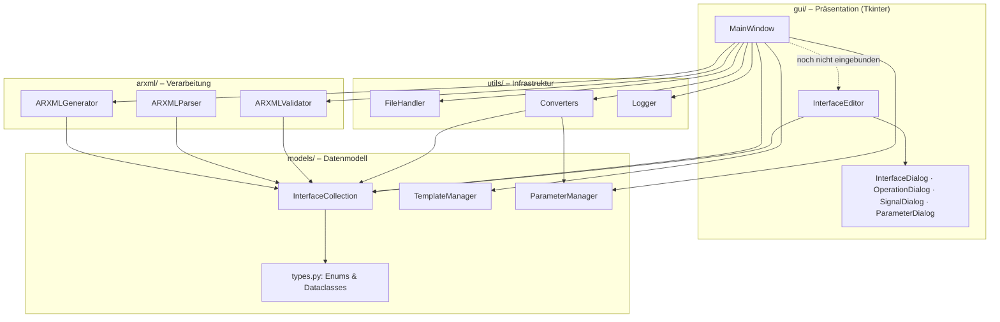
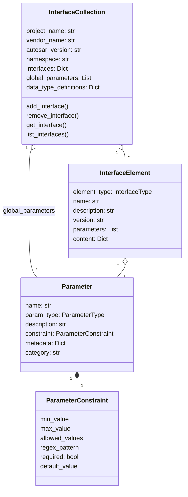
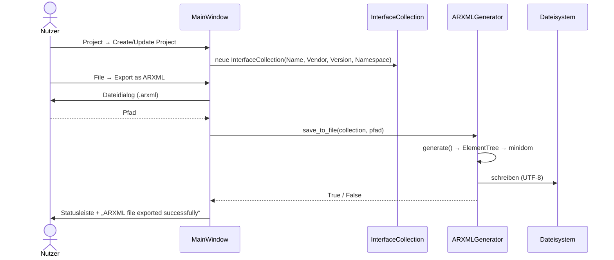

# Architektur

Überblick über Schichten, Module und Datenfluss des ARXML GUI Generators.

[← zurück zur README](../README.md)

---

## Schichten

Abhängigkeiten zeigen nur nach unten: `models/` kennt weder GUI noch ARXML, `arxml/` kennt
keine GUI. Dadurch lassen sich Generator, Validator und Modell ohne Tkinter verwenden und
testen (siehe [Python-API](python-api.md)).

## Module

| Modul | Verantwortung | Wichtige Klassen |
|---|---|---|
| `main.py` | Start, Tk-Root, Hauptschleife, Logging bei Start/Ende | `main()` |
| `gui/main_window.py` | Menüs, Reiter, Statusleiste, verbindet GUI mit Modell und Generator | `MainWindow` |
| `gui/interface_editor.py` | Interface-Liste als `ttk.Frame` mit Hinzufügen/Bearbeiten/Löschen | `InterfaceEditor` |
| `gui/dialogs.py` | modale Eingabedialoge | `InterfaceDialog`, `OperationDialog`, `SignalDialog`, `ParameterDialog` |
| `arxml/generator.py` | Modell → XML-Text bzw. Datei | `ARXMLGenerator` |
| `arxml/parser.py` | XML → Modell | `ARXMLParser` |
| `arxml/validators.py` | Regeln für Namen, Metadaten, Constraints | `ARXMLValidator`, `ValidationError` |
| `models/types.py` | Enums und Basis-Dataclasses | `InterfaceElement`, `Parameter`, `ParameterConstraint`, … |
| `models/interface.py` | Projektcontainer und Vorlagen | `InterfaceCollection`, `TemplateManager`, `ParameterTemplate`, `InterfaceTemplate` |
| `models/parameter.py` | Parameterwerte in Gruppen, Einzelwert-Prüfungen | `ParameterManager`, `ParameterGroup`, `ParameterValue`, `ParameterValidator` |
| `utils/file_handler.py` | JSON/CSV/Pickle-I/O, Dateihelfer | `FileHandler` (statisch) |
| `utils/converters.py` | Modell ↔ dict/JSON/CSV-Zeilen | `Converters` (statisch) |
| `utils/logger.py` | Singleton-Logger (Konsole + Datei) | `Logger`, `get_logger()` |

## Datenmodell

### Bewusste Designentscheidung: generisches `content`

`InterfaceElement` ist für alle Interface-Typen gleich; typspezifische Daten (Service-Typ,
Operationen, Port-Typ, Signale, Datentyp) liegen als Dictionary in `content`. Vorteile:
einfache JSON-Serialisierung und ein einziger Code-Pfad in Dialogen und Konvertern.
Nachteil: keine Typprüfung durch Python – Tippfehler in Schlüsseln (z. B. `"signal"` statt
`"signals"`) werden still ignoriert.

Die spezifischeren Dataclasses `ServiceInterface`, `PortInterface`, `Signal` und `Operation`
in `types.py` sind definiert, werden aktuell aber nirgends verwendet. Bei der Umstellung auf
schemakonforme ARXML bietet es sich an, auf diese (oder pydantic-Modelle) umzusteigen.

### Zwei Parametermodelle

| Modell | Zweck | Verwendet von |
|---|---|---|
| `models.types.Parameter` | **Definition** eines Parameters (Typ, Grenzen, Default) | Interfaces, Operationen, Vorlagen, Generator, Validator |
| `models.parameter.ParameterValue` | konkreter **Wert** eines Parameters in einer Gruppe | `ParameterManager`, Konverter für CSV/JSON |

Beide sind derzeit nicht miteinander verknüpft.

## Ablauf: ARXML exportieren

## Fehlerbehandlung und Logging

- `FileHandler`, `ARXMLGenerator.save_to_file` und `ARXMLParser` fangen Ausnahmen ab, geben
  sie mit `print()` auf der Konsole aus und liefern `False`/`None`. Die GUI prüft den
  Rückgabewert, zeigt im Fehlerfall aber (noch) keinen Dialog.
- Der `Logger` ist ein Singleton um das Standard-`logging`. Er legt beim ersten Aufruf
  `logs/` im Arbeitsverzeichnis an. Ausnahmen in den Modulen werden bisher nicht über den
  Logger, sondern per `print()` gemeldet.

## Erweiterungspunkte

| Vorhaben | Ansatzpunkt |
|---|---|
| neuer Interface-Typ | `InterfaceType` erweitern, `ARXMLGenerator.generate()` + eigene `_add_…`-Methode, Parser `_parse_element()`, Typauswahl in `InterfaceDialog` |
| neue Validierungsregel | Methode in `ARXMLValidator`, Aufruf in `_validate_interface()` bzw. `_validate_parameter()` |
| neue Parameter-Vorlage | `TemplateManager._initialize_builtin_templates()` oder zur Laufzeit `add_parameter_template()` |
| neues Exportformat | statische Methode in `Converters`, Schreiben über `FileHandler`, Menüeintrag in `MainWindow._create_menu()` |
| Mehrsprachige GUI | Beschriftungen in `gui/` zentralisieren (derzeit fest auf Englisch) |
