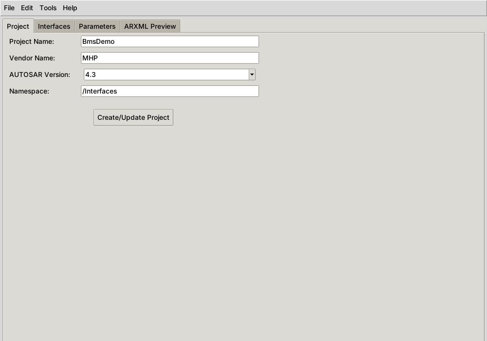
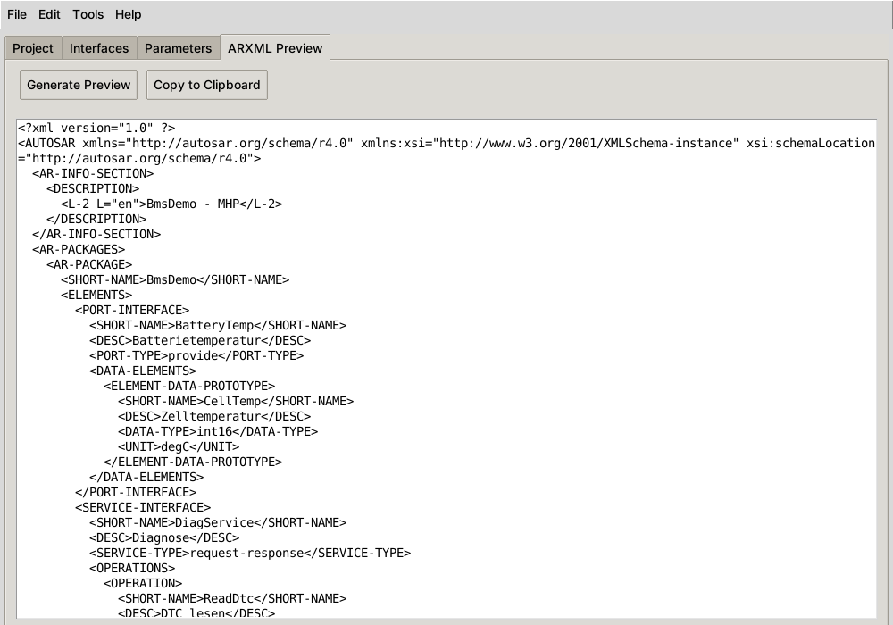

# Benutzerhandbuch

Dieses Handbuch beschreibt die Oberfläche des ARXML GUI Generators im aktuellen
Entwicklungsstand. Funktionen, die in der GUI noch Platzhalter sind, sind ausdrücklich
markiert – für diese gibt es jeweils einen Weg über die [Python-API](python-api.md).

[← zurück zur README](../README.md)

---

## Inhalt

- [Programm starten](#programm-starten)
- [Aufbau des Hauptfensters](#aufbau-des-hauptfensters)
- [Reiter „Project“](#reiter-project)
- [Reiter „Interfaces“](#reiter-interfaces)
- [Reiter „Parameters“](#reiter-parameters)
- [Reiter „ARXML Preview“](#reiter-arxml-preview)
- [Menüreferenz](#menüreferenz)
- [Typische Abläufe](#typische-abläufe)
- [Validierung und Meldungen](#validierung-und-meldungen)
- [Logdateien](#logdateien)
- [Fehlerbehebung](#fehlerbehebung)

---

## Programm starten

```bash
cd arxml-gui
python main.py
```

Das Hauptfenster öffnet sich mit 1000 × 700 Pixeln. In der Konsole erscheinen
Statusmeldungen, parallel wird eine Logdatei unter `logs/` angelegt (siehe [Logdateien](#logdateien)).

> Die Oberfläche ist derzeit englischsprachig, die Dokumentation deutsch. Die Bezeichnungen
> im Handbuch entsprechen exakt den Beschriftungen in der GUI.

## Aufbau des Hauptfensters

```
┌───────────────────────────────────────────────────────────┐
│ File  Edit  Tools  Help                          Menüleiste │
├───────────────────────────────────────────────────────────┤
│ [Project] [Interfaces] [Parameters] [ARXML Preview]  Reiter│
│                                                           │
│                      Arbeitsbereich                       │
│                                                           │
├───────────────────────────────────────────────────────────┤
│ Ready                                         Statusleiste │
└───────────────────────────────────────────────────────────┘
```

Die **Statusleiste** zeigt die zuletzt ausgeführte Aktion, z. B. `Project created/updated`
oder `ARXML exported: <Pfad>`.

## Reiter „Project“



Hier werden die Stammdaten des Projekts festgelegt. Erst nach **Create/Update Project**
existiert intern ein Projekt – vorher melden Vorschau, Export, Speichern und Validierung
„No project …“.

| Feld | Standardwert | Verwendung |
|---|---|---|
| **Project Name** | `MyProject` | `SHORT-NAME` des erzeugten `AR-PACKAGE`; Pflichtfeld bei der Validierung |
| **Vendor Name** | `VendorName` | erscheint in der Beschreibung im Kopf der ARXML (`<Projekt> - <Vendor>`); leer ⇒ Warnung |
| **AUTOSAR Version** | `4.3` | Auswahl `4.2`, `4.3`, `4.4`; wird validiert und in der Projektdatei gespeichert |
| **Namespace** | `/Interfaces` | wird im Projekt und in der Projektdatei gespeichert, fließt aber **noch nicht** in die ARXML ein |

**Create/Update Project** legt das Projekt mit den eingetragenen Werten an.

> **Achtung:** Die Schaltfläche erzeugt jedes Mal ein **neues, leeres** Projekt. Bereits
> vorhandene Interfaces gehen dabei verloren. Stammdaten daher vor dem Hinzufügen von
> Inhalten festlegen.

Hinweis zur AUTOSAR-Version: Alle drei Versionen verwenden denselben XML-Namespace
`http://autosar.org/schema/r4.0`. Die Auswahl wirkt sich derzeit nur auf die Validierung
und die Projektdatei aus, nicht auf den Inhalt der ARXML.

## Reiter „Interfaces“

Zeigt die Schaltflächen **+ Add Interface**, **- Remove Interface** und **Edit Interface**
sowie eine Liste.

> 🚧 **Noch nicht angebunden.** Die drei Schaltflächen öffnen derzeit nur einen Hinweis
> („… will be implemented“). Die Liste wird nicht befüllt.

Im Code sind die eigentlichen Dialoge bereits vorhanden (`gui/interface_editor.py`,
`gui/dialogs.py`) und werden mit dem nächsten Schritt der [Roadmap](entwicklung.md#roadmap)
eingebunden. Sie sehen folgenden Ablauf vor:

1. **Interface Editor**: Typ wählen (`SERVICE`, `PORT`, `SIGNAL`), Name und Beschreibung eingeben.
   - bei `SERVICE`: Service-Typ `REQUEST_RESPONSE`, `FIRE_AND_FORGET` oder `PUBLISH_SUBSCRIBE`, Liste von Operationen
   - bei `PORT`: Port-Typ `PROVIDE`, `REQUIRE` oder `PROVIDE_REQUIRE`, Liste von Signalen
   - bei `SIGNAL`: nur Name und Beschreibung
2. **Operation Editor**: Name, Beschreibung, Ein- und Ausgabeparameter (je über den Parameter Editor).
3. **Signal Editor**: Name, Datentyp (`uint8` … `uint64`, `int8` … `int64`, `float32`, `float64`, `boolean`, `string`), Einheit, Beschreibung, Initialwert.
4. **Parameter Editor**: Name, Typ (`int`, `float`, `string`, `boolean`, `enum`), Beschreibung, Min-, Max- und Default-Wert.

Bis dahin: Interfaces per Skript anlegen, siehe [Python-API → Interfaces anlegen](python-api.md#interfaces-anlegen).

## Reiter „Parameters“

Tabelle mit den Spalten *Group*, *Name*, *Value*, *Type*, *Unit* und den Schaltflächen
**+ Add Group**, **+ Add Parameter**, **Load Template**.

> 🚧 **Noch nicht angebunden.** *Add Group* und *Add Parameter* zeigen einen Hinweis.
> *Load Template* listet nur die Namen der eingebauten Vorlagen.

Eingebaute Parameter-Vorlagen:

| Vorlage | Parameter |
|---|---|
| `timing` | `timeout` (ms), `cycle_time` (ms), `delay` (ms) |
| `communication` | `baudrate`, `data_bits` (7–8), `stop_bits` (1–2), `parity` (none/odd/even) |
| `safety` | `asil_level` (A–D), `fault_tolerance`, `error_recovery` |

## Reiter „ARXML Preview“



*Das Bildschirmfoto zeigt ein Projekt, dessen Interfaces per Python-API hinzugefügt wurden.*

| Schaltfläche | Wirkung |
|---|---|
| **Generate Preview** | erzeugt die ARXML aus dem aktuellen Projekt und zeigt sie an |
| **Copy to Clipboard** | kopiert den Inhalt des Textfelds in die Zwischenablage |

Die Vorschau ist ein normales Textfeld. Änderungen darin werden **nicht** zurück ins
Projekt übernommen und beim Export nicht berücksichtigt – exportiert wird immer neu aus dem
Projekt. *Copy to Clipboard* kopiert dagegen genau den angezeigten (ggf. von Hand
geänderten) Text.

Ohne Interfaces enthält die Vorschau nur den Rahmen (`AUTOSAR`, `AR-INFO-SECTION`,
`AR-PACKAGE` mit leerem `ELEMENTS`). Aufbau im Detail: [ARXML-Ausgabe](arxml-ausgabe.md).

## Menüreferenz

### File

| Eintrag | Funktion | Status |
|---|---|---|
| **New Project** | verwirft das aktuelle Projekt und leert Listen und Vorschau | ✅ |
| **Open Project** | liest eine Projektdatei (`.json`) | ⚠️ Datei wird gelesen und „Project loaded“ gemeldet, der Inhalt wird aber noch nicht ins Projekt übernommen |
| **Save Project** | speichert das Projekt als JSON ([Format](datenformate.md#projektdatei)) | ✅ |
| **Export as ARXML** | schreibt die ARXML (`.arxml` oder `.xml`) | ✅ |
| **Import ARXML** | Dateiauswahl für eine ARXML | 🚧 meldet Erfolg, liest die Datei aber nicht ein |
| **Exit** | beendet die Anwendung | ✅ |

### Edit

| Eintrag | Funktion | Status |
|---|---|---|
| **Add Interface** | wie *+ Add Interface* im Reiter Interfaces | 🚧 |
| **Add Parameter Group** | wie *+ Add Group* im Reiter Parameters | 🚧 |

### Tools

| Eintrag | Funktion | Status |
|---|---|---|
| **Validate Project** | prüft das Projekt, siehe [Validierung](#validierung-und-meldungen) | ✅ |
| **Export Parameters (CSV)** | Parameter als CSV | 🚧 |
| **Export Parameters (JSON)** | Parameter als JSON | 🚧 |

### Help

| Eintrag | Funktion |
|---|---|
| **About** | Version und Copyright |

## Typische Abläufe

### ARXML-Gerüst für ein neues Projekt erzeugen (nur GUI)

1. **Project**: Name `BmsDemo`, Vendor `MHP`, Version `4.3` → **Create/Update Project**
2. **Tools → Validate Project** → „Project is valid!“
3. **ARXML Preview → Generate Preview** zur Kontrolle
4. **File → Export as ARXML** → `BmsDemo.arxml`

### Vollständige ARXML mit Interfaces erzeugen (Skript + GUI)

1. Interfaces wie in [Python-API](python-api.md#komplettes-beispiel) beschrieben per Skript anlegen
   und direkt als ARXML speichern **oder** als Projekt-JSON ablegen.
2. Bis *Open Project* vollständig umgesetzt ist, ist der Skriptweg der zuverlässige Weg für
   Dateien mit Inhalt.

### Projekt sichern

**File → Save Project** schreibt Stammdaten und alle Interfaces (Typ, Name, Beschreibung,
Inhalt) als eingerücktes JSON – gut geeignet für Versionskontrolle und Reviews.
Interface-Parameter und globale Parameter werden derzeit **nicht** mitgespeichert,
siehe [Datenformate](datenformate.md#projektdatei).

## Validierung und Meldungen

**Tools → Validate Project** prüft:

| Prüfung | Schwere | Meldung |
|---|---|---|
| Projektname leer | ERROR | `Project name is required` |
| Vendor leer | WARNING | `Vendor name is not set` |
| Version nicht 4.2/4.3/4.4 | ERROR | `Unsupported AUTOSAR version: …` |
| Interface-Name kein gültiger Bezeichner¹ | ERROR | `Invalid interface name format …` |
| Interface-Name enthält Leerzeichen | WARNING | `Interface name contains spaces` |
| Parameter-Name kein gültiger Bezeichner¹ | ERROR | `Invalid parameter name format` |
| Min-Wert größer als Max-Wert | ERROR | `Min value is greater than max value` |
| Default-Wert außerhalb Min/Max bzw. nicht in erlaubten Werten | ERROR | `Default value violates constraints` |

¹ Gültiger Bezeichner: beginnt mit Buchstabe oder `_`, danach nur Buchstaben, Ziffern und
`_`, höchstens 128 Zeichen (Regex `^[a-zA-Z_][a-zA-Z0-9_]*$`).

Gibt es nur Warnungen, gilt das Projekt als gültig und es erscheint „Project is valid!“ –
die Warnungen selbst werden in diesem Fall nicht angezeigt. Bei mindestens einem Fehler
erscheinen alle Befunde (erst Fehler, dann Warnungen) in einem Dialog, z. B.:

```
[ERROR] METADATA on 'ProjectName': Project name is required
[ERROR] INTERFACE on '1 bad name': Invalid interface name format (must start with letter, contain only alphanumeric and underscore)
[WARNING] METADATA on 'VendorName': Vendor name is not set
[WARNING] INTERFACE on '1 bad name': Interface name contains spaces
```

Nicht geprüft werden derzeit: Namen von Operationen und Signalen, doppelte Namen über
Interface-Typen hinweg, Gültigkeit der Datentypen und die Konformität zum AUTOSAR-XSD.

## Logdateien

Bei jedem Start wird im **aktuellen Arbeitsverzeichnis** ein Ordner `logs/` angelegt und
eine Datei `arxml_gui_JJJJMMTT_HHMMSS.log` geschrieben.

- Datei: alle Meldungen ab DEBUG
- Konsole: ab INFO
- Format: `2026-11-05 10:32:04 - arxml_gui - INFO - Application started`

`*.log` ist per `.gitignore` von der Versionskontrolle ausgenommen. Alte Logs werden nicht
automatisch gelöscht.

## Fehlerbehebung

| Problem | Ursache / Lösung |
|---|---|
| `ModuleNotFoundError: No module named 'tkinter'` | Tkinter fehlt – siehe [Voraussetzungen](../README.md#voraussetzungen) |
| `_tkinter.TclError: no display name and no $DISPLAY environment variable` | kein Grafik-Server, z. B. per SSH oder in WSL ohne WSLg. Lokal starten, WSLg nutzen oder für Tests `xvfb-run python main.py` |
| `ModuleNotFoundError: No module named 'models'` | Programm/Skript nicht aus dem Projektverzeichnis gestartet |
| „No project to … Create one first.“ | zuerst im Reiter *Project* auf **Create/Update Project** klicken |
| Interfaces verschwunden nach *Create/Update Project* | Schaltfläche legt ein neues Projekt an – siehe Hinweis im Reiter [Project](#reiter-project) |
| Export meldet keinen Erfolg | Fehlermeldung steht in der Konsole (`Error saving ARXML: …`) |
