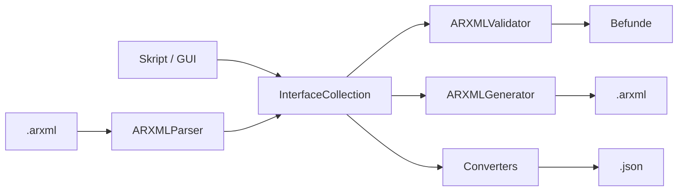

# Python-API

Alle Funktionen der Anwendung stehen auch als Python-Module zur Verfügung. Das ist im
aktuellen Stand der zuverlässigste Weg, um ARXML-Dateien **mit Inhalt** zu erzeugen, da das
Anlegen von Interfaces in der GUI noch nicht angebunden ist.

[← zurück zur README](../README.md)

---

## Inhalt

- [Grundlagen](#grundlagen)
- [Projekt anlegen](#projekt-anlegen)
- [Interfaces anlegen](#interfaces-anlegen)
  - [Service-Interface](#service-interface)
  - [Port-Interface](#port-interface)
  - [System-Signal](#system-signal)
  - [Parameter an einem Interface](#parameter-an-einem-interface)
- [Validieren](#validieren)
- [ARXML erzeugen](#arxml-erzeugen)
- [ARXML einlesen](#arxml-einlesen)
- [Vorlagen](#vorlagen)
- [Parametergruppen](#parametergruppen)
- [Konverter und Dateien](#konverter-und-dateien)
- [Komplettes Beispiel](#komplettes-beispiel)
- [Referenz: Enums](#referenz-enums)

---

## Grundlagen

Skripte müssen aus dem Projektverzeichnis gestartet werden (oder das Verzeichnis muss im
`PYTHONPATH` liegen), da die Pakete `models`, `arxml` und `utils` relativ importiert werden:

```bash
cd arxml-gui
python mein_skript.py
# oder von woanders:
PYTHONPATH=/pfad/zu/arxml-gui python mein_skript.py
```

Das zentrale Objekt ist die **`InterfaceCollection`** – ein Projekt mit Stammdaten und einem
Dictionary von Interfaces. Generator, Validator, Parser und Konverter arbeiten alle auf
diesem Objekt.



## Projekt anlegen

```python
from models.interface import InterfaceCollection

projekt = InterfaceCollection(
    project_name="BmsDemo",     # Pflicht – wird SHORT-NAME des AR-PACKAGE
    vendor_name="MHP",          # Standard: "VendorName"
    autosar_version="4.3",      # "4.2" | "4.3" | "4.4", Standard: "4.3"
    namespace="/Interfaces",    # Standard: "/Interfaces" (wird noch nicht in die ARXML geschrieben)
)
```

Methoden der `InterfaceCollection`:

| Methode | Beschreibung |
|---|---|
| `add_interface(interface)` | fügt hinzu bzw. **überschreibt** ein Interface gleichen Namens |
| `remove_interface(name) -> bool` | entfernt, `False` falls nicht vorhanden |
| `get_interface(name)` | liefert das Interface oder `None` |
| `list_interfaces() -> list[str]` | Namen in Einfügereihenfolge |
| `add_global_parameter(parameter)` | globaler Parameter (wird validiert, aber nicht in die ARXML geschrieben) |
| `add_data_type(name, definition)` | eigene Datentyp-Definition (derzeit nur gespeichert, nicht ausgegeben) |

## Interfaces anlegen

Jedes Interface ist ein `InterfaceElement`. Der Typ bestimmt, welche Schlüssel im
Dictionary `content` ausgewertet werden:

```python
from models.types import InterfaceElement, InterfaceType

InterfaceElement(
    element_type=InterfaceType.SERVICE,   # SERVICE | PORT | SIGNAL
    name="DiagService",                   # gültiger Bezeichner, siehe Validierung
    description="Diagnosedienste",
    version="1.0.0",                      # derzeit nicht ausgegeben
    parameters=[],                        # Liste von Parameter-Objekten
    content={...},                        # typabhängig, siehe unten
)
```

> `InterfaceType` kennt zusätzlich `OPERATION` und `EVENT`. Diese Typen werden vom
> Generator aber nicht ausgegeben – Interfaces dieser Typen fehlen in der ARXML.

### Service-Interface

| Schlüssel in `content` | Typ | Ausgabe |
|---|---|---|
| `service_type` | `str`: `"request-response"`, `"fire-and-forget"`, `"publish-subscribe"` | `SERVICE-TYPE` (Standard `request-response`) |
| `operations` | Liste von Dicts | `OPERATIONS/OPERATION` |

Aufbau einer Operation:

| Schlüssel | Typ | Ausgabe |
|---|---|---|
| `name` | `str` | `SHORT-NAME` |
| `description` | `str` | `DESC` |
| `input_parameters` | Liste von **`Parameter`-Objekten** | `INPUT-PARAMETERS` |
| `output_parameters` | Liste von **`Parameter`-Objekten** | `OUTPUT-PARAMETERS` |

```python
from models.types import Parameter, ParameterType, ParameterConstraint

projekt.add_interface(InterfaceElement(
    element_type=InterfaceType.SERVICE,
    name="DiagService",
    description="Diagnosedienste",
    content={
        "service_type": "request-response",
        "operations": [
            {
                "name": "ReadDtc",
                "description": "Fehlerspeicher lesen",
                "input_parameters": [
                    Parameter(name="dtc_mask", param_type=ParameterType.INT, description="Statusmaske",
                              constraint=ParameterConstraint(min_value=0, max_value=255)),
                ],
                "output_parameters": [
                    Parameter(name="dtc_count", param_type=ParameterType.INT, description="Anzahl DTCs"),
                ],
            },
        ],
    },
))
```

> ⚠️ Ein- und Ausgabeparameter müssen `Parameter`-Objekte sein. Dictionaries (wie sie der
> noch nicht eingebundene `ParameterDialog` liefert) führen beim Generieren zu
> `AttributeError: 'dict' object has no attribute 'name'`.
> Umgekehrt lässt sich ein Projekt mit `Parameter`-Objekten in Operationen derzeit nicht als
> JSON speichern, siehe [Datenformate](datenformate.md#einschränkungen).

### Port-Interface

| Schlüssel in `content` | Typ | Ausgabe |
|---|---|---|
| `port_type` | `str`: `"provide"`, `"require"`, `"provide-require"` | `PORT-TYPE` (Standard `provide`) |
| `signals` | Liste von Dicts | `DATA-ELEMENTS/ELEMENT-DATA-PROTOTYPE` |

Aufbau eines Signals:

| Schlüssel | Typ | Ausgabe |
|---|---|---|
| `name` | `str` | `SHORT-NAME` |
| `description` | `str` | `DESC` |
| `data_type` | `str`, z. B. `"uint8"`, `"int16"`, `"float32"` | `DATA-TYPE` |
| `unit` | `str` | `UNIT` |
| `init_value` | beliebig | wird bei Port-Signalen derzeit **nicht** ausgegeben |

```python
projekt.add_interface(InterfaceElement(
    element_type=InterfaceType.PORT,
    name="BatteryTemp",
    description="Batterietemperatur",
    content={
        "port_type": "provide",
        "signals": [
            {"name": "CellTemp", "data_type": "int16", "unit": "degC", "description": "Zelltemperatur"},
            {"name": "CoolantTemp", "data_type": "int16", "unit": "degC", "description": "Kühlmitteltemperatur"},
        ],
    },
))
```

### System-Signal

| Schlüssel in `content` | Typ | Ausgabe |
|---|---|---|
| `data_type` | `str` | `DATA-TYPE` |
| `init_value` | beliebig | `INIT-VALUE` (als Text) |

```python
projekt.add_interface(InterfaceElement(
    element_type=InterfaceType.SIGNAL,
    name="VehicleSpeed",
    description="Fahrzeuggeschwindigkeit",
    content={"data_type": "uint16", "init_value": 0},
))
```

### Parameter an einem Interface

Service- und Port-Interfaces können zusätzlich eine Parameterliste tragen
(`InterfaceElement.parameters`), die als `PARAMETERS/PARAMETER-DATA-PROTOTYPE` ausgegeben wird:

```python
projekt.get_interface("DiagService").parameters.append(
    Parameter(
        name="timeout",
        param_type=ParameterType.INT,
        description="Timeout in ms",
        constraint=ParameterConstraint(min_value=0, max_value=1000, default_value=100),
        metadata={"owner": "Diagnose"},
    )
)
```

Felder von `Parameter` und `ParameterConstraint`:

| Feld | Standard | Ausgabe |
|---|---|---|
| `name` | – | `SHORT-NAME` |
| `param_type` | – | `TYPE-REFERENCE`, siehe Zuordnung unten |
| `description` | `""` | `DESC` |
| `constraint.min_value` | `None` | `MIN-VALUE` |
| `constraint.max_value` | `None` | `MAX-VALUE` |
| `constraint.default_value` | `None` | `DEFAULT-VALUE` |
| `constraint.allowed_values` | `None` | nur Validierung |
| `constraint.regex_pattern` | `None` | derzeit ungenutzt |
| `constraint.required` | `True` | derzeit ungenutzt |
| `metadata` | `{}` | `METADATA/PROPERTY` (KEY/VALUE) |
| `category` | `"general"` | derzeit ungenutzt |

Zuordnung `param_type` → `TYPE-REFERENCE`: `int → uint32`, `float → float32`,
`string → string`, `boolean → boolean`, `enum → enum`, `complex → complex`.
Akzeptiert werden sowohl `ParameterType`-Werte als auch die entsprechenden Strings.

## Validieren

```python
from arxml.validators import ARXMLValidator

validator = ARXMLValidator()
ok, befunde = validator.validate_collection(projekt)

for b in befunde:
    print(b.severity, b.error_type, b.element, b.message)
# oder einfach: print(b)  →  "[ERROR] INTERFACE on 'x': ..."

validator.get_errors()    # nur ERROR
validator.get_warnings()  # nur WARNING
```

`ok` ist `True`, wenn es keine Fehler gibt (Warnungen sind erlaubt). Die Prüfregeln stehen im
[Benutzerhandbuch](benutzerhandbuch.md#validierung-und-meldungen).

## ARXML erzeugen

```python
from arxml.generator import ARXMLGenerator

generator = ARXMLGenerator(autosar_version="4.3")
xml_text = generator.generate(projekt)                 # str
erfolg = generator.save_to_file(projekt, "out.arxml")  # bool, UTF-8
```

`save_to_file` gibt bei Fehlern `False` zurück und schreibt die Ursache auf die Konsole.
Der Aufbau der Datei ist in [ARXML-Ausgabe](arxml-ausgabe.md) beschrieben.

## ARXML einlesen

```python
from arxml.parser import ARXMLParser

parser = ARXMLParser()
projekt = parser.parse_file("eingabe.arxml")   # oder parse_string(text)
```

Aktueller Umfang des Parsers:

- erkennt `SERVICE-INTERFACE`, `PORT-INTERFACE` und `SYSTEM-SIGNAL`
- übernimmt jeweils `SHORT-NAME` und `DESC`, bei Services die Namen und Beschreibungen
  der Operationen, bei Ports die der `ELEMENT-DATA-PROTOTYPE`s
- der Projektname wird aus dem `SHORT-NAME` des **letzten** `AR-PACKAGE` gesetzt

> ⚠️ **Einschränkung:** Der Parser findet nur Elemente **ohne XML-Namespace**. Echte
> AUTOSAR-Dateien – und auch die vom eigenen Generator erzeugten Dateien – deklarieren
> `xmlns="http://autosar.org/schema/r4.0"` und liefern deshalb ein leeres Projekt. Ein
> Round-Trip Generator → Parser funktioniert daher noch nicht.

## Vorlagen

```python
from models.interface import TemplateManager

tm = TemplateManager()
tm.list_parameter_templates()          # ['timing', 'communication', 'safety']
timing = tm.get_parameter_template("Timing")   # Groß-/Kleinschreibung egal
for p in timing.get_parameters():      # Kopie der Liste
    print(p.name, p.param_type, p.description)
```

Eigene Vorlagen:

```python
from models.interface import ParameterTemplate, InterfaceTemplate

tm.add_parameter_template(ParameterTemplate(
    name="Diagnose", category="diagnostics",
    parameters=[Parameter(name="p2_server_max", param_type=ParameterType.INT, description="ms")],
))
tm.add_interface_template(InterfaceTemplate(name="StandardPort", interface_type="port"))
```

> In den eingebauten Vorlagen ist `param_type` als String (`"int"`, …) hinterlegt, nicht als
> `ParameterType`. Generator und Validator kommen damit zurecht.

## Parametergruppen

`models/parameter.py` enthält ein vom Interface-Modell unabhängiges Modell für konkrete
Parameter**werte**, gruppiert nach Themen. Es ist für den Parameter-Reiter und den
CSV/JSON-Export vorgesehen.

```python
from models.parameter import ParameterManager, ParameterGroup, ParameterValue, ParameterValueType

pm = ParameterManager()
pm.add_group(ParameterGroup(name="Timing", description="Zeitparameter"))
pm.add_parameter_to_group("Timing", ParameterValue(name="cycle_time", value=10, unit="ms"))
pm.add_parameter_to_group("Timing", ParameterValue(
    name="timeout", value="2*cycle_time", value_type=ParameterValueType.COMPUTED, unit="ms"))

pm.list_groups()          # ['Timing']
pm.export_to_dict()       # verschachteltes dict
```

`ParameterValueType`: `STATIC`, `DYNAMIC`, `COMPUTED`, `REFERENCE` – derzeit rein beschreibend,
es findet keine Auswertung statt.

Einzelwerte prüfen mit `ParameterValidator` (alle Methoden statisch, Rückgabe `bool`):

```python
from models.parameter import ParameterValidator as PV

PV.validate_int("42", min_val=0, max_val=100)     # True
PV.validate_float(3.5, max_val=3.0)               # False
PV.validate_string("ABC", pattern=r"^[A-Z]+$", max_length=8)  # True
PV.validate_boolean("yes")                        # True
PV.validate_enum("odd", ["none", "odd", "even"])  # True
PV.validate_regex("CAN_1", r"^CAN_\d$")           # True
```

## Konverter und Dateien

```python
from utils.converters import Converters
from utils.file_handler import FileHandler

# Projekt ↔ JSON
json_text = Converters.interface_collection_to_json(projekt)
FileHandler.save_json(Converters.interface_collection_to_dict(projekt), "projekt.json")

# Parametergruppen ↔ JSON / CSV
json_text = Converters.parameters_to_json(pm.groups)
FileHandler.save_csv(Converters.parameters_to_csv_rows(pm.groups), "parameter.csv")
gruppen = Converters.json_string_to_parameters(json_text)
```

`FileHandler` bietet außerdem `load_json`, `load_csv`, `save_pickle`/`load_pickle`,
`file_exists`, `delete_file`, `get_file_size` und `list_files(verzeichnis, endung)`. Alle
Methoden fangen Ausnahmen ab, schreiben sie auf die Konsole und liefern `False`/`None`.

> Pickle-Dateien nur aus vertrauenswürdigen Quellen laden – beim Entpacken kann beliebiger
> Code ausgeführt werden.

Formate im Detail: [Datenformate](datenformate.md).

## Komplettes Beispiel

Erzeugt eine ARXML mit einem Service-, einem Port-Interface und einem System-Signal,
validiert vorher und bricht bei Fehlern ab:

```python
"""beispiel_bms.py – im Projektverzeichnis ausführen: python beispiel_bms.py"""
import sys

from models.interface import InterfaceCollection
from models.types import (
    InterfaceElement, InterfaceType, Parameter, ParameterType, ParameterConstraint,
)
from arxml.generator import ARXMLGenerator
from arxml.validators import ARXMLValidator

projekt = InterfaceCollection(project_name="BmsDemo", vendor_name="MHP", autosar_version="4.3")

projekt.add_interface(InterfaceElement(
    element_type=InterfaceType.SERVICE,
    name="DiagService",
    description="Diagnosedienste",
    content={
        "service_type": "request-response",
        "operations": [{
            "name": "ReadDtc",
            "description": "Fehlerspeicher lesen",
            "input_parameters": [Parameter(name="dtc_mask", param_type=ParameterType.INT)],
            "output_parameters": [Parameter(name="dtc_count", param_type=ParameterType.INT)],
        }],
    },
    parameters=[Parameter(
        name="timeout", param_type=ParameterType.INT, description="Timeout in ms",
        constraint=ParameterConstraint(min_value=0, max_value=1000, default_value=100),
    )],
))

projekt.add_interface(InterfaceElement(
    element_type=InterfaceType.PORT,
    name="BatteryTemp",
    description="Batterietemperatur",
    content={
        "port_type": "provide",
        "signals": [{"name": "CellTemp", "data_type": "int16", "unit": "degC",
                     "description": "Zelltemperatur"}],
    },
))

projekt.add_interface(InterfaceElement(
    element_type=InterfaceType.SIGNAL,
    name="VehicleSpeed",
    description="Fahrzeuggeschwindigkeit",
    content={"data_type": "uint16", "init_value": 0},
))

ok, befunde = ARXMLValidator().validate_collection(projekt)
for b in befunde:
    print(b)
if not ok:
    sys.exit(1)

if ARXMLGenerator(projekt.autosar_version).save_to_file(projekt, "BmsDemo.arxml"):
    print("BmsDemo.arxml geschrieben")
```

## Referenz: Enums

Alle in `models/types.py`:

| Enum | Werte (`.value`) |
|---|---|
| `InterfaceType` | `service`, `port`, `signal`, `operation`, `event` |
| `ServiceType` | `request-response`, `fire-and-forget`, `publish-subscribe` |
| `PortType` | `provide`, `require`, `provide-require` |
| `ParameterType` | `int`, `float`, `string`, `boolean`, `enum`, `complex` |
| `DataType` | `uint8`, `uint16`, `uint32`, `uint64`, `int8`, `int16`, `int32`, `int64`, `float32`, `float64`, `boolean`, `string` |

> Die Dataclasses `Signal`, `Operation`, `ServiceInterface` und `PortInterface` sind
> definiert, werden vom Generator aber nicht verwendet – er arbeitet ausschließlich mit
> `InterfaceElement` und den Dictionaries in `content`.
